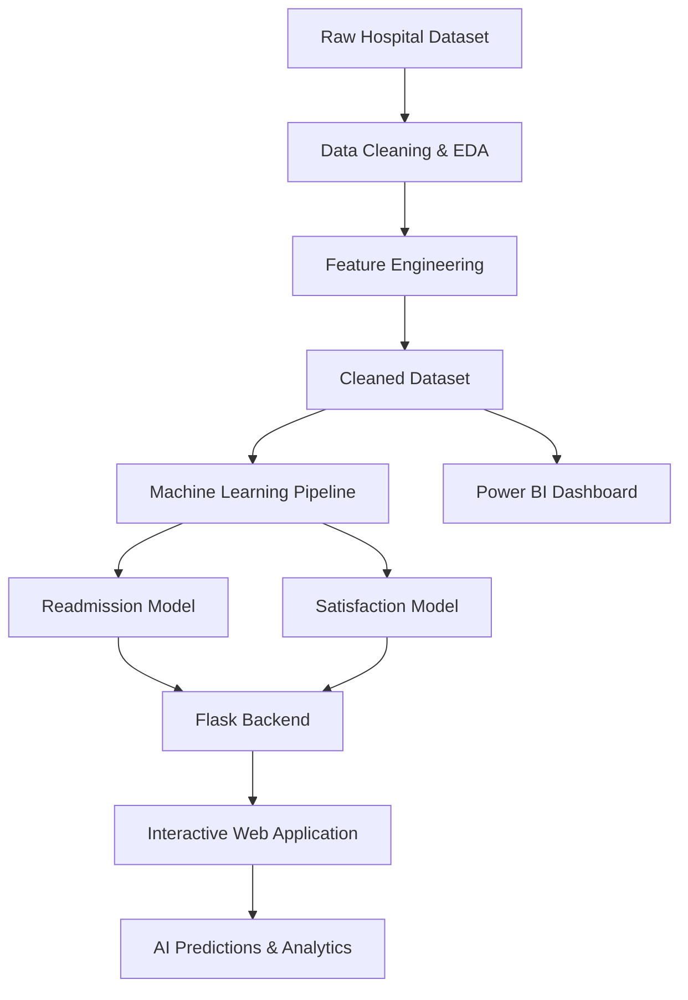

# 🏥 HealthPulse AI – Hospital Analytics & Predictive Decision System

An end-to-end healthcare analytics and AI-powered hospital management solution that combines data analysis, machine learning, an interactive web application, and Power BI dashboards to support data-driven healthcare decisions.

## 📌 Table of Contents
- [Project Overview](#-project-overview)
- [Key Features](#-key-features)
- [System Architecture](#-system-architecture)
- [Machine Learning Models](#-machine-learning-models)
- [Power BI Dashboard](#-power-bi-dashboard)
- [Data Processing](#-data-processing)
- [Technology Stack](#-technology-stack)
- [Project Structure](#-project-structure)
- [Installation & Setup](#-installation--setup)
- [How to Use](#-how-to-use)
- [Key Insights](#-key-insights)
- [Disclaimer](#-disclaimer)

---

## 💡 Project Overview

**HealthPulse AI** is a comprehensive hospital analytics platform designed to analyze patient records, monitor hospital performance, and predict important healthcare outcomes.

The project focuses on two major predictive tasks:

1. **Hospital Readmission Prediction:** Predicts the likelihood of a patient being readmitted within 30 days.
2. **Patient Satisfaction Prediction:** Estimates patient satisfaction ratings on a scale of 1–5.

The solution integrates a Flask-based web application with machine learning models and a Power BI dashboard suite to provide interactive analytics and predictive insights.

## 🚀 Key Features

### 1. Executive Hospital Dashboard
- Total patient admissions and hospital costs.
- Average length of hospital stay.
- Hospital readmission rate.
- Average patient satisfaction score.
- Interactive charts for patient demographics, medical conditions, and procedures.

### 2. AI-Powered Clinical Predictor
- Predicts 30-day patient readmission risk.
- Displays readmission probability.
- Estimates patient satisfaction ratings.
- Categorizes risk into Critical, Moderate, and Low levels.
- Provides automated follow-up guidance.

### 3. Patient Registry Management
- Search patients by Patient ID, condition, or procedure.
- Filter records by medical condition and readmission status.
- View paginated patient records.
- Register new patient admissions.

### 4. Deep Analytics
- Patient satisfaction analysis by age.
- Length-of-stay segmentation.
- Healthcare cost comparisons.
- Readmission pattern analysis.

### 5. Multi-Colour Theme Engine

The application supports five customizable themes:

| Theme | Primary Color |
|---|---|
| Ocean Blue | `#0284c7` |
| Clinical Emerald | `#059669` |
| Royal Purple | `#7c3aed` |
| Sunset Coral | `#ea580c` |
| Midnight Cyber | `#38bdf8` |

Themes dynamically update charts and interface elements.

## 🏗️ System Architecture



## 🤖 Machine Learning Models

### 1. 30-Day Hospital Readmission Prediction

**Problem Type:** Binary Classification

- Target: `Readmission_Flag`
- Features: Age, Gender, Condition, Cost, Length of Stay, and Outcome.
- Validation: 80/20 Stratified Train-Test Split.
- Preprocessing: StandardScaler and OneHotEncoder using Scikit-Learn pipelines.

#### Model Performance

| Algorithm | Accuracy | ROC-AUC |
|---|---:|---:|
| Logistic Regression | 86.29% | 0.9539 |
| Gradient Boosting | 98.98% | 0.9846 |
| Random Forest | 98.98% | 0.9959 |

### 2. Patient Satisfaction Prediction

**Problem Type:** Regression and Multiclass Classification

- Target: `Satisfaction`
- Features: Age, Gender, Condition, Cost, Length of Stay, Readmission, and Outcome.

#### Regression Performance

| Algorithm | R² Score | RMSE | MAE |
|---|---:|---:|---:|
| Ridge Regression | 0.9652 | 0.1674 | 0.1264 |
| Random Forest Regressor | 1.0000 | 0.0000 | — |

**Multiclass Classification:** Random Forest Classifier achieved 100% accuracy across four satisfaction rating classes in the reported evaluation.

*Note: These are reported dataset evaluation results, not guarantees of performance on unseen hospital populations. Further validation is required before any real-world clinical use.*

## 📊 Power BI Dashboard

The project includes a native Power BI project (`.pbip`) with three analytical pages.

### Page 1: Executive Operations & Hospital Overview
- Total admissions, hospital costs, average stay, readmission rate, and satisfaction.
- Patient gender distribution.
- Patient volume by medical condition.
- Discharge outcomes by condition.

### Page 2: Clinical Readmission & Quality Risk
- Readmission rate by medical condition.
- Length of stay versus treatment cost.
- Patient risk drill-through analysis.

### Page 3: Financial Efficiency & Patient Experience
- Treatment cost versus satisfaction across age groups.
- Procedure expense treemap.
- Condition-wise readmission and satisfaction analysis.

Additional components:
- 10 custom DAX measures.
- Power Query transformations.
- Five healthcare dashboard themes.

## 🧹 Data Processing

The project uses a hospital dataset containing **984 patient admission records**.

| Dataset | Records | Columns |
|---|---:|---:|
| Original Dataset | 984 | 10 |
| Cleaned Dataset | 984 | 15 |

### Data Cleaning
- Checked missing values and duplicate records.
- Removed leading and trailing whitespace.
- Standardized numeric data types.
- Prepared categorical and numerical features.

### Feature Engineering
- `Readmission_Flag`: Binary readmission indicator.
- `Outcome_Recovered`: Recovery outcome indicator.
- `Cost_per_Day`: Healthcare cost divided by length of stay.
- `Age_Group`: Young Adult, Middle-Aged, and Senior.
- `LOS_Category`: Short, Medium, and Long Stay.

## 🛠️ Technology Stack

| Category | Technologies |
|---|---|
| Programming | Python |
| Backend | Flask |
| Frontend | HTML5, Tailwind CSS, JavaScript |
| Machine Learning | Scikit-Learn |
| Data Analysis | Pandas, NumPy |
| Visualization | Matplotlib, Seaborn, Chart.js |
| Business Intelligence | Power BI, DAX, Power Query |
| Model Serialization | Joblib |
| Development | Jupyter Notebook, VS Code |

## 📂 Project Structure

```text
HealthPulse-AI-Hospital-Dashboard/
│
├── app.py
├── run_app.bat
│
├── templates/
│   └── index.html
│
├── models/
│   ├── readmission_model.joblib
│   └── satisfaction_model.joblib
│
├── Power BI/
│   ├── Hospital_Analytics_Dashboard.pbip
│   ├── Hospital_Analytics_Dashboard.Report/
│   ├── Hospital_Analytics_Dashboard.SemanticModel/
│   ├── dax_measures.dax
│   └── healthcare_theme.json
│
├── Data/
│   ├── hospital data analysis.csv
│   └── hospital_data_cleaned.csv
│
├── data.ipynb
└── README.md
```

*The structure above summarizes the main project components. Update folder names if your GitHub repository uses a different layout.*

## ⚙️ Installation & Setup

### Step 1: Clone the Repository

```bash
git clone https://github.com/jatinparashar76-tech/HealthPulse-AI-Hospital-Dashboard.git
```

### Step 2: Navigate to the Project

```bash
cd HealthPulse-AI-Hospital-Dashboard
```

### Step 3: Create a Virtual Environment

```bash
python -m venv venv
```

Activate it on Windows:

```bash
venv\Scripts\activate
```

### Step 4: Install Dependencies

```bash
pip install flask pandas numpy scikit-learn joblib matplotlib seaborn
```

### Step 5: Run the Application

```bash
python app.py
```

### Step 6: Open in Browser

Visit:

```text
http://127.0.0.1:5000
```

### Step 7: Open Power BI

Open `Hospital_Analytics_Dashboard.pbip` using Power BI Desktop.

### Step 8: Explore the Notebook

```bash
jupyter notebook data.ipynb
```

## 📈 Key Insights

Based on the provided dataset analysis:

1. **Cardiology Readmissions:** Heart Attack and Heart Disease records show particularly high readmission rates.
2. **Patient Satisfaction:** Age and healthcare costs show negative associations with satisfaction scores.
3. **Length of Stay:** Patient stays can be segmented into short, medium, and long-duration groups.
4. **Healthcare Operations:** Interactive dashboards help monitor admissions, costs, patient outcomes, and readmission patterns.

## 🎯 Project Objectives

- Apply end-to-end data science workflows to healthcare data.
- Build predictive machine learning pipelines.
- Develop an interactive full-stack analytics application.
- Integrate machine learning predictions into a web interface.
- Create Power BI dashboards for operational and clinical analysis.
- Demonstrate practical applications of AI in healthcare analytics.

## ⚠️ Disclaimer

HealthPulse AI is an educational and analytical project. Its predictions and recommendations are not clinically validated and must not be used as a substitute for professional medical judgment or real-world clinical decision-making. Model performance requires independent validation, especially because unusually high evaluation scores may indicate data leakage or other evaluation limitations.

## 👨‍💻 Author

**Jatin Parashar**

Data Science | Machine Learning | Python | SQL | Power BI

---

⭐ If you find this project interesting, consider giving the repository a star!
